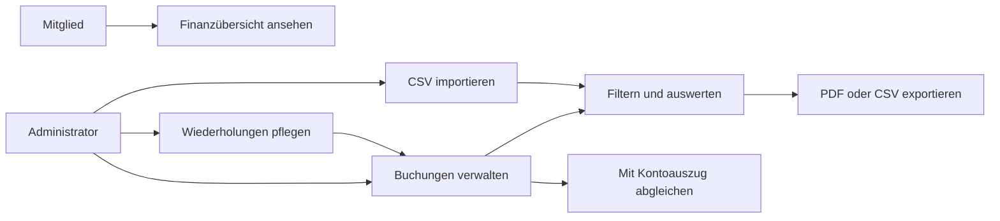
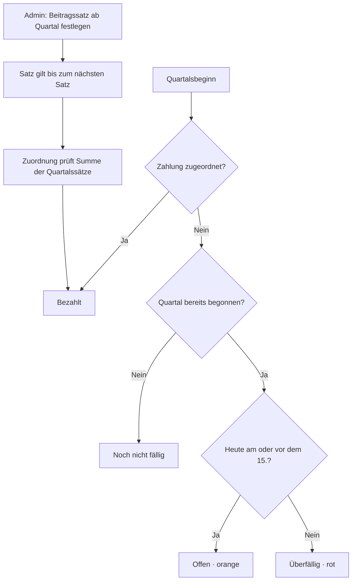
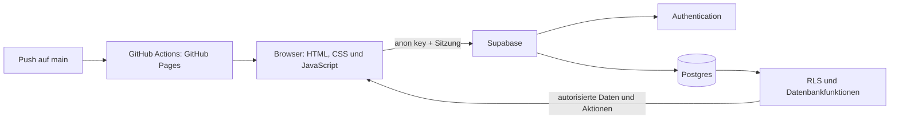

# UHC Prinzen – Mannschaftskasse

Die Anwendung verwaltet die Mannschaftskasse der Wesselbleker Prinzen. Sie
zeigt Bank- und PayPal-Salden, Einnahmen und Ausgaben sowie den Zahlungsstatus
der Quartalsbeiträge. Mitglieder sehen die Finanzübersicht nach der Anmeldung;
Administratoren verwalten Buchungen, Beiträge und Einstellungen.

## Fachliche Anleitung

### Anmelden und Überblick

Jedes Mitglied meldet sich mit einem persönlichen Supabase-Konto an. Die
Finanzdaten sind nur nach der Anmeldung sichtbar. Die Übersicht zeigt den
Gesamtsaldo sowie die Bank- und PayPal-Salden, Einnahmen, Ausgaben und
Auswertungen für den ausgewählten Zeitraum.

### Buchungen und Auswertungen

Administratoren können Einnahmen und Ausgaben erfassen, ändern, löschen oder
gelöschte Buchungen wiederherstellen. Buchungen lassen sich nach Zeitraum,
Konto, Text, Buchungsart und Abgleichstatus filtern. Gespeicherte Filter bleiben
im jeweiligen Browser erhalten.

CSV-Dateien können vor dem Import geprüft und angepasst werden; PDF- und
CSV-Exporte verwenden die aktiven Filter. Exporte sind auf 5.000 Buchungen
begrenzt. Buchungen können nach dem Abgleich mit dem Kontoauszug einzeln oder
gesammelt als abgeglichen markiert werden. Wiederholungsbuchungen werden als
Vorlagen gepflegt und nur nach manueller Bestätigung erzeugt.



### Quartalsbeiträge

Die Kassenverwaltung beginnt am **01.10.2026**. Administratoren tragen den
Bank- und PayPal-Startsaldo zu diesem Datum ein. Frühere Buchungen werden nicht
in die Verwaltung übernommen.

Die Beitragsübersicht zeigt den Status jedes Mitglieds ab Q4 2026. Der Beitrag
ist bis einschließlich **15. des ersten Monats im Quartal** fällig: Offene
Beiträge sind bis zu diesem Datum orange, ab dem 16. rot und überfällig.
Beiträge künftiger Quartale sind als noch nicht fällig gekennzeichnet.

Administratoren verwalten die Mitgliederliste und können Beitragssätze ab einem
Quartal festlegen. Ein Satz gilt ab seinem Wirksamkeitsquartal bis zum nächsten
Satz. Eine Einnahmebuchung kann einem Mitglied und einem oder mehreren
aufeinanderfolgenden Quartalen zugeordnet werden. Der Buchungsbetrag muss der
Summe der in diesen Quartalen gültigen Beitragssätze entsprechen; gespeicherte
Zuordnungen behalten ihre ursprünglichen Quartalsbeträge. Korrekturen erfolgen
durch Aufheben der gesamten Zuordnung, nicht durch Ändern der Zahlung.



## Developer-Anleitung

### Lokal starten

Die Anwendung ist statisch und benötigt keinen Build-Schritt oder eigenen
Anwendungsserver. Zum lokalen Ausführen genügt ein statischer HTTP-Server:

```sh
python3 -m http.server 8080 --directory src
```

Anschließend <http://localhost:8080> öffnen. Es gibt kein `package.json` und
keine projektweite Test-Suite. Für eine schnelle Prüfung:

```sh
node --check src/scripts/app.js
git diff --check
```

### Architektur

- `src/index.html` – Seitenstruktur und Dialoge
- `src/scripts/app.js` – Supabase-Zugriffe, Finanzlogik und Benutzeroberfläche
- `src/styles/` – Layout und responsive Gestaltung
- `src/supabase-config.js` – öffentliche Supabase-Projekt-URL und anon key
- `supabase/base-schema.sql` – Grundschema für ein neues Projekt
- `supabase/schema.sql` – Delta-Schema für bestehende Projekte



### Supabase einrichten

Für ein neues Projekt zuerst `supabase/base-schema.sql`, danach
`supabase/schema.sql` im Supabase SQL Editor ausführen. Bei einem bestehenden
Projekt nur `supabase/schema.sql` ausführen. **Das Delta-Skript löscht
Buchungen vor dem 01.10.2026 samt zugehörigem Änderungsverlauf und
Beitragszuordnungen endgültig. Vor der Ausführung ein Datenbank-Backup
erstellen.** Belegdateien im Storage werden dabei nicht gelöscht.

Die Projekt-URL und der **anon public key** gehören in
`src/supabase-config.js`. Niemals den `service_role`-Key im Frontend oder in
versionierten Dateien hinterlegen. RLS und Datenbankfunktionen erzwingen die
Berechtigungen zusätzlich zur Oberfläche.

Mitglieder benötigen jeweils einen eigenen Benutzer unter
**Authentication → Users**. Administratoren erhalten serverseitig
`app_metadata.role: "admin"`; `bvbrulez@gmail.com` ist zusätzlich als
Administrator fest hinterlegt. Rollenänderungen ausschließlich über einen
vertrauenswürdigen Supabase-Admin-Kontext vornehmen, nie aus dem Browser.

### Deployment und Changelog

Ein Push auf `main` veröffentlicht `src/` über die GitHub Action automatisch
auf GitHub Pages. Der versionierte Hook ergänzt beim Commit die geänderten
Dateien im `CHANGELOG.md`. Einmal pro Clone aktivieren:

```sh
git config core.hooksPath .githooks
chmod +x .githooks/pre-commit
```
